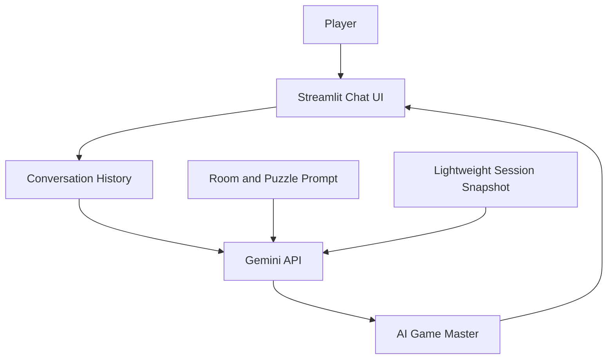
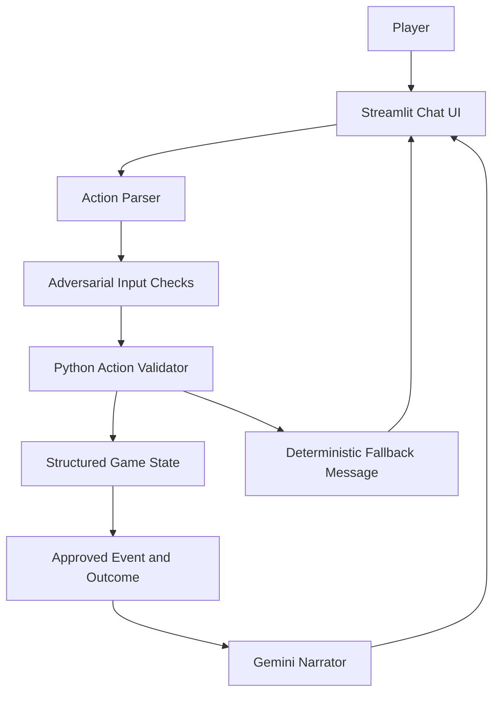

# System Architecture

## Version 1 — Interactive AI Escape Room

**Explanation:** The player sends natural-language messages through Streamlit. The application sends the conversation, room description and intended puzzle path to Gemini. Gemini generates the Game Master's response. Conversation history is retained in Streamlit session state. Since the model is the primary decision-maker, it can forget details or describe invalid progress.

## Version 2 — Reliable AI Escape Room

**Explanation:** Python owns the state and all game-changing decisions. The parser identifies an action, the validator checks prerequisites and updates the structured state only when allowed. Gemini receives only the approved event and outcome, and is asked to narrate them without changing rules. If Gemini is unavailable, the deterministic message is displayed.

## Key design decision

The LLM is useful for natural language and engaging narration, but it should not be the source of truth for game rules. In Version 2, Python owns the inventory, puzzle flags, drawer status, door status and escape condition.
